# Fajr-Alarm

An open-source, serverless, **Local-First / BYOK** Flutter mobile alarm app engineered to ensure you wake up for Fajr prayer. The alarm enforces **Proof-of-Action** (a standing POV photo of your feet on a prayer rug verified via your own Google Gemini Vision API key, with tilt-sensor checks and offline barcode/typing fallbacks) backed by relentless native OS alarm engines.

> **Target Platforms (`v1.0`):** Android 10+ (`minSdk 29`, `targetSdk 35`) and iOS 26+ (`AlarmKit`). `iOS 15–25` is deferred past `v1.0`.

---

## Screenshots

### Onboarding Flow (Arabic Dark & English Light)

| Location Setup | Permissions Gate | BYOK Gemini Key & Consent | Bathroom Barcode |
| :---: | :---: | :---: | :---: |
| 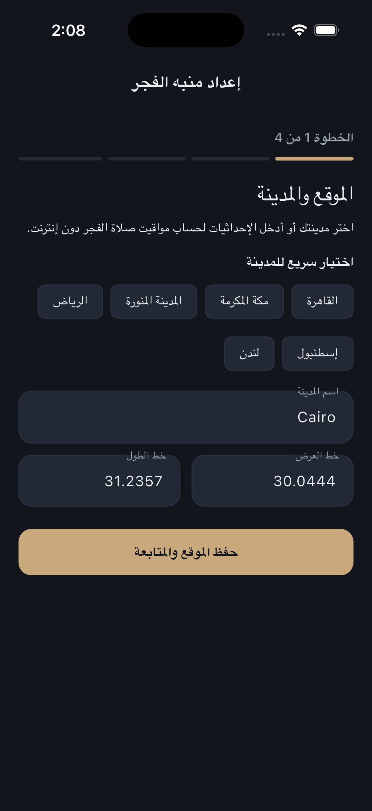 | 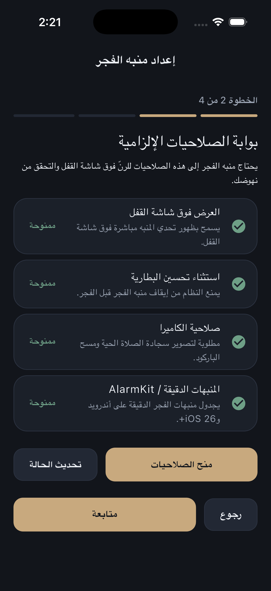 | 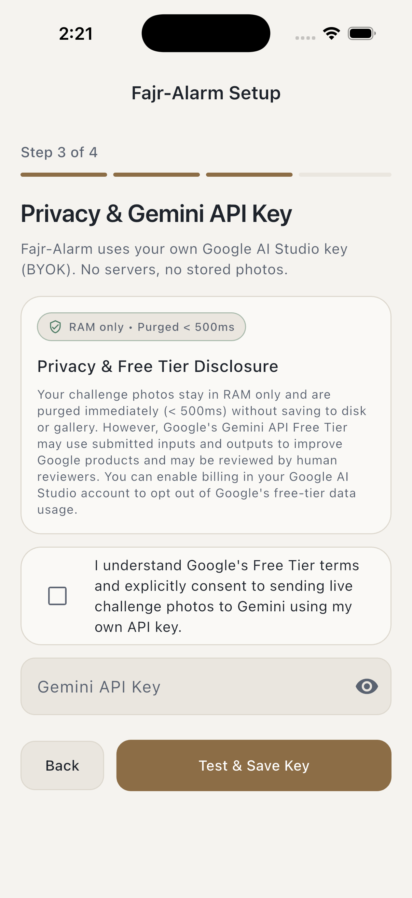 | 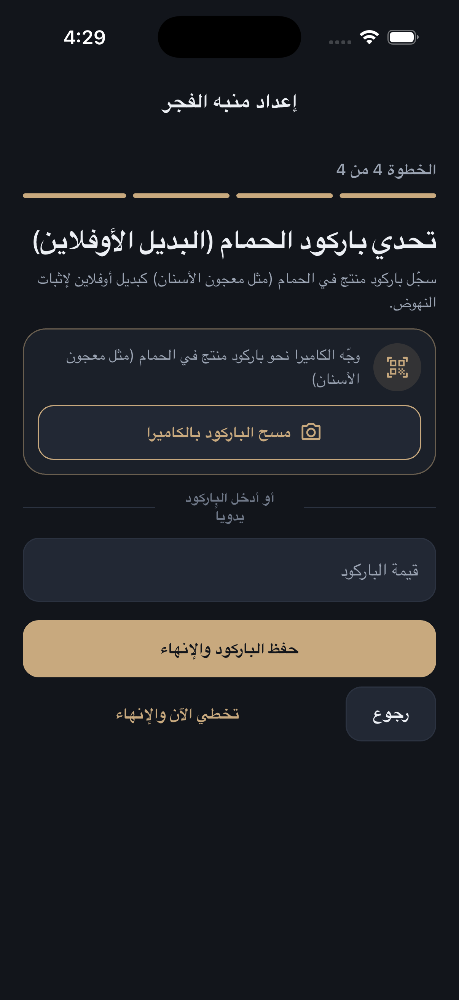 |

### Core Screens (Prayer Schedule, Relentless Alarm, Proof-of-Action & Settings)

| Prayer Schedule (AR Dark) | Prayer Schedule (EN Light) | Alarm Ringing (AR Dark) | Settings & Streak (AR Dark) |
| :---: | :---: | :---: | :---: |
| 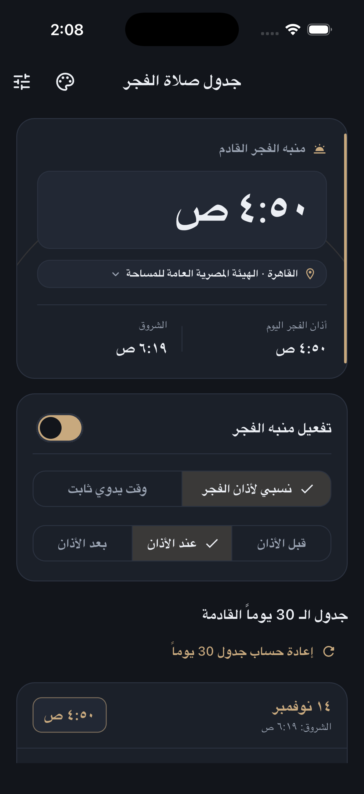 | 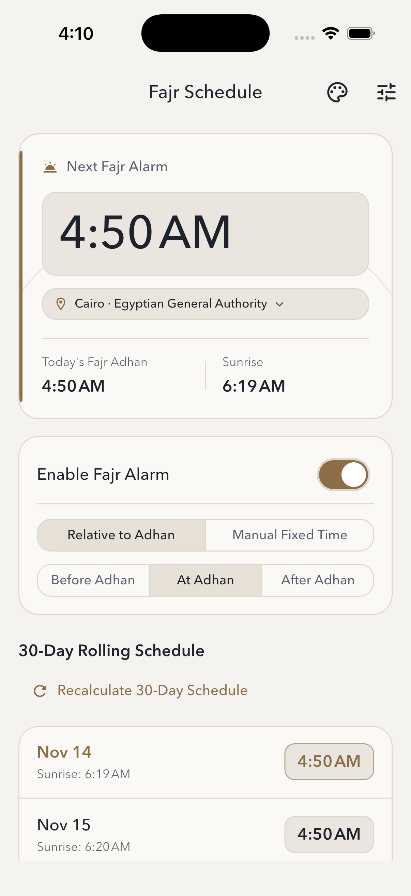 | 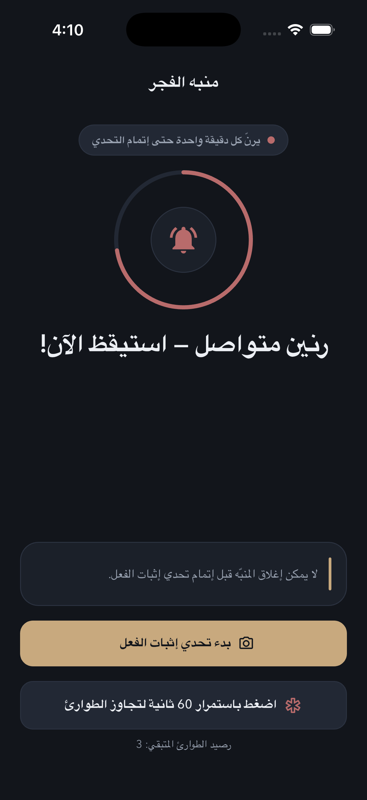 | 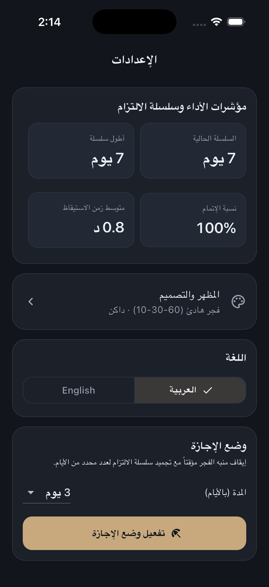 |

### Proof-of-Action Verification & Fallbacks

| Rug POV Camera (AR Dark) | Rug POV Camera (EN Light) | Standing Typing Fallback | Settings & Streak (EN Light) |
| :---: | :---: | :---: | :---: |
| 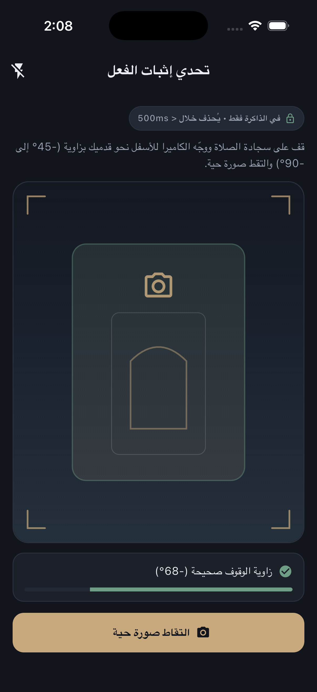 | 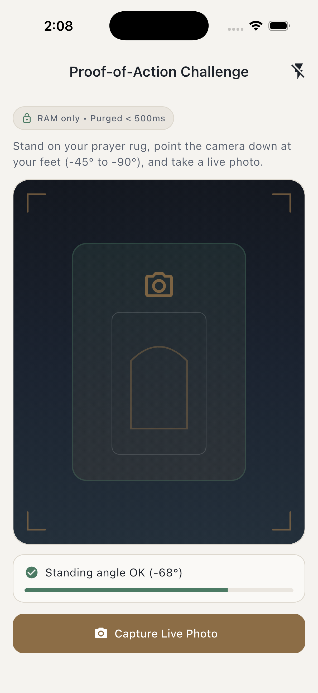 | 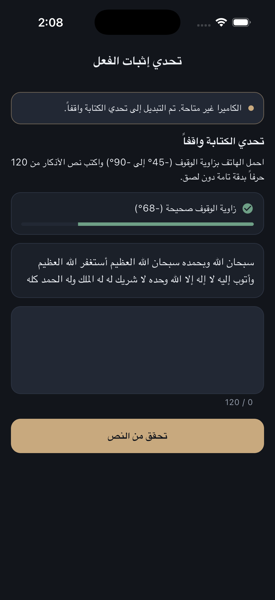 | 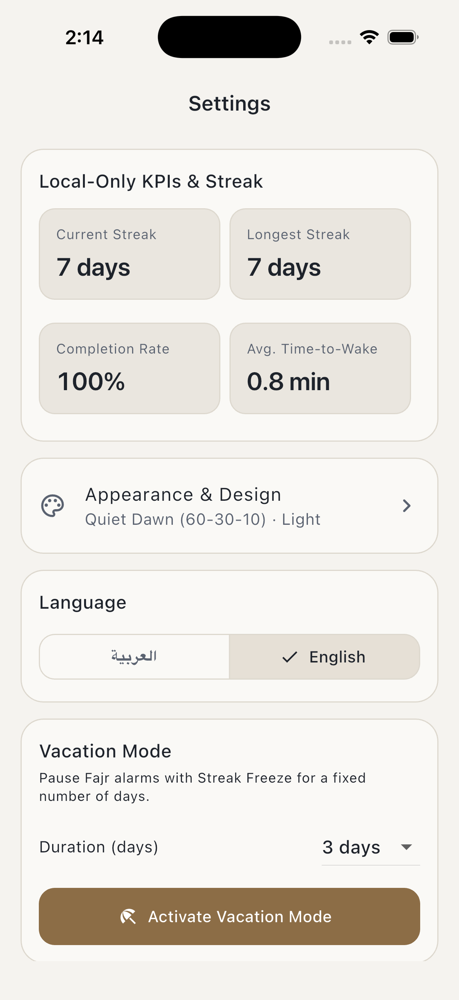 |

---

## Interactive Architecture Map (Floorplan)

Explore the entire codebase visually — all 142 source & test files, 12 modules, 2 end-to-end flows, and a 5-stop guided onboarding tour:

- **Standalone Interactive Map (Offline HTML):** Open [`docs/architecture-map.html`](docs/architecture-map.html) in any browser (download/clone and open locally).
- **Live Floorplan Server (with Ask bar):**
  ```bash
  node floorplan/serve.mjs
  ```

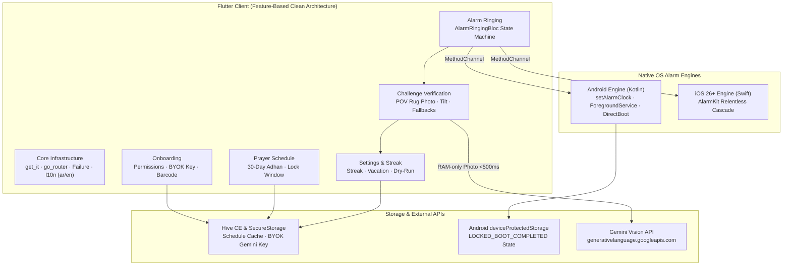

---

## Key Features & Engineering Guarantees

- **Relentless Alarm Engines:**
  - **Android:** `USE_EXACT_ALARM` + `setAlarmClock()`, `FullScreenIntent`, `ForegroundService` (`mediaPlayback`), `LOCKED_BOOT_COMPLETED` via `DirectBootReceiver`, `AudioManager.STREAM_ALARM` volume enforcement + `onKeyDown` hardware-button interception, and `startLockTask()`.
  - **iOS 26+:** Native Swift channel driving `AlarmKit` (`Relentless AlarmKit Cascade` + `LiveActivityIntent`).
- **Proof-of-Action Verification:**
  - **Primary:** Standing POV photo of feet on a prayer rug verified via user-supplied Gemini Vision API (`generativelanguage.googleapis.com`), gated by `sensors_plus` tilt-angle verification.
  - **Offline Fallbacks:** Bathroom barcode scan (`mobile_scanner`) and standing typing challenge.
- **Privacy & Zero Secrets:**
  - Serverless & local-first: zero developer backend or telemetry.
  - BYOK Gemini API key is stored exclusively in `FlutterSecureStorage` (explicit consent captured during onboarding for Gemini free-tier terms).
  - Captured verification photos remain in RAM only and are purged immediately (`< 500ms`).
- **Bilingual & RTL-First:** Full Arabic (`ar`) and English (`en`) localization via `.arb` files (`AppLocalizations`) with RTL-safe widgets.

---

## Architecture

The codebase follows **Feature-Based Clean Architecture** with strict layer boundaries:

```text
lib/
├── core/                         # DI (get_it), theme, go_router, Failure union, l10n, monotonic clock
└── features/
    └── <feature>/
        ├── domain/
        │   ├── entities/         # Immutable pure Dart entities (zero Flutter/storage/network imports)
        │   ├── repositories/     # Abstract repository contracts
        │   └── usecases/         # Single-responsibility use cases returning Either<Failure, T>
        ├── data/
        │   ├── datasources/      # Hive CE, FlutterSecureStorage, Dio, Sensors, Platform Channels
        │   ├── models/           # Freezed / json_serializable DTOs mapped to domain entities
        │   └── repositories/     # Repository implementations & caching coordination
        └── presentation/
            ├── bloc/ | cubit/    # flutter_bloc state machines & immutable Freezed states
            ├── pages/            # Route screens
            └── widgets/          # Reusable const UI components
```

### Feature Modules

| Module | Responsibility | Key Entry Points |
|---|---|---|
| **Core** | DI (`get_it`), `Failure` union, `go_router`, theme, `ar`/`en` l10n | [`injection.dart`](lib/core/di/injection.dart), [`app_router.dart`](lib/core/router/app_router.dart) |
| **Onboarding** | Permissions gate, location, BYOK Gemini key + consent, barcode setup | [`onboarding_cubit.dart`](lib/features/onboarding/presentation/bloc/onboarding_cubit.dart) |
| **Prayer Schedule** | 30-day offline `adhan` Fajr calculation, Hive cache, pre-Fajr lock window | [`prayer_schedule_cubit.dart`](lib/features/prayer_schedule/presentation/bloc/prayer_schedule_cubit.dart) |
| **Alarm Ringing** | Relentless alarm state machine, snooze/complete/emergency override | [`alarm_ringing_bloc.dart`](lib/features/alarm_ringing/presentation/bloc/alarm_ringing_bloc.dart) |
| **Challenge Verification** | Gemini Vision rug POV photo, tilt sensor, offline barcode/typing fallbacks | [`challenge_cubit.dart`](lib/features/challenge_verification/presentation/cubit/challenge_cubit.dart) |
| **Settings & Streak** | Preferences, Fajr streak stats, vacation mode, emergency quota, dry-run | [`settings_cubit.dart`](lib/features/settings_and_streak/presentation/cubit/settings_cubit.dart) |
| **Native Android** | Exact alarms, `ForegroundService`, `DirectBootReceiver`, `AlarmStorage` | [`AlarmForegroundService.kt`](android/app/src/main/kotlin/com/elgenius/fajralarm/fajr_alarm/AlarmForegroundService.kt) |
| **Native iOS 26+** | `AlarmKit` Relentless Cascade & `LiveActivityIntent` bridge | [`AlarmKitManager.swift`](ios/Runner/AlarmKitManager.swift) |

---

## Developer Onboarding & Quick Start

### Prerequisites

- **Flutter / Dart SDK:** Dart `^3.13.4` (see [`pubspec.yaml`](pubspec.yaml))
- **Tooling (for codebase navigation & scripts):** `python3`, `node`, `jq`, and optionally `graphify`

### 1. Install Dependencies & Run Codegen

```bash
flutter pub get
flutter gen-l10n
dart run build_runner build --delete-conflicting-outputs
```

### 2. Run Static Analysis & Tests

```bash
# Formatting & static analysis (zero warnings/infos required)
dart format --set-exit-if-changed .
dart analyze --fatal-infos

# Run unit, BLoC, and widget tests with coverage
flutter test --coverage
```

### 3. Navigate the Codebase Fast (Search Ladder)

Before grepping across the repo, walk this ladder in order:

1. **Conceptual Map:** Read [`docs/TOPIC_INDEX.md`](docs/TOPIC_INDEX.md) to jump straight to domain entry points.
2. **Exact Symbol Lookup:** Query the generated symbol index:
   ```bash
   jq '.AlarmRingingBloc' docs/SYMBOLS.json
   ```
3. **References & Definitions:** Use the Dart Language Server (`flutter_dart-mcp-server` / IDE LSP).
4. **Structural Graph:** Query `graphify` (e.g. `graphify affected "PrayerScheduleRepository" --depth 2` or `graphify explain "AlarmKitManager.swift"`).
5. **Visual Map:** Open [`docs/architecture-map.html`](docs/architecture-map.html) for the interactive Floorplan.

---

## Documentation & Governance

- **Canonical Spec:** [`docs/SRS-Fajr-alarm.md`](docs/SRS-Fajr-alarm.md)
- **Project Constitution:** [`.claude/CONSTITUTION.md`](.claude/CONSTITUTION.md)
- **AI Agent Guidelines:** [`CLAUDE.md`](CLAUDE.md) · [`AGENTS.md`](AGENTS.md)
- **Domain & Issue Docs:** [`docs/agents/domain.md`](docs/agents/domain.md) · [`docs/agents/issue-tracker.md`](docs/agents/issue-tracker.md)
- **Topic Index:** [`docs/TOPIC_INDEX.md`](docs/TOPIC_INDEX.md)

---

## Contributing

1. **Branch & PR Only:** Never push directly to `main` (enforced by `.claude/hooks/block-push-to-main.sh`).
2. **Test-Driven Development:** Maintain **80%+** test coverage across domain, BLoC/Cubit, and repository layers.
3. **Localization:** Never hardcode user-visible strings; add all copy to both `ar` and `en` `.arb` files and verify RTL layout.
4. **Commit Format:** Use conventional commits (`feat:`, `fix:`, `refactor:`, `docs:`, `test:`, `chore:`).
